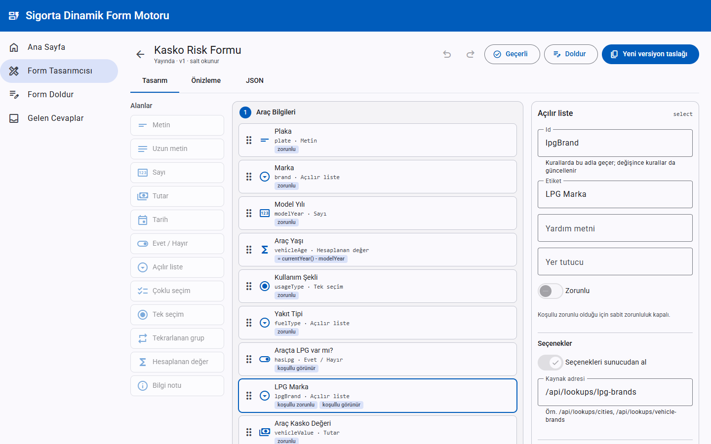
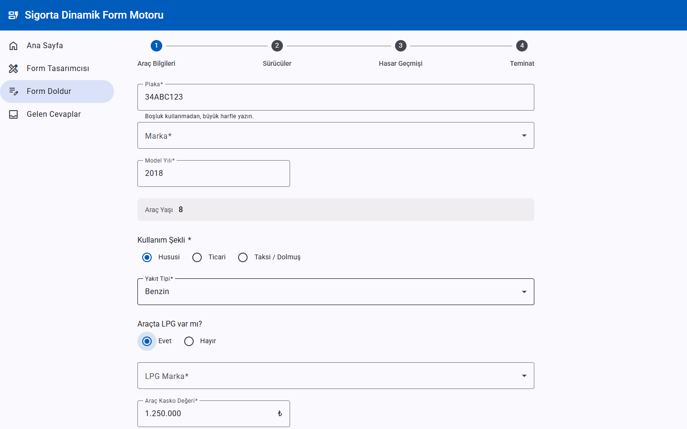
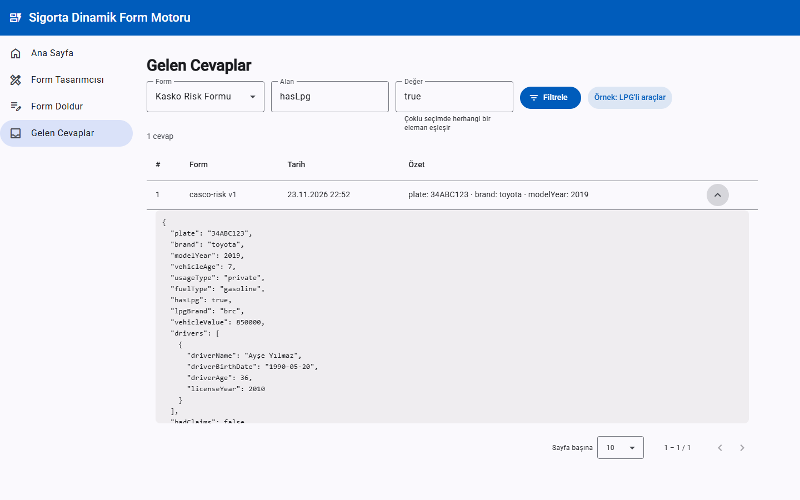
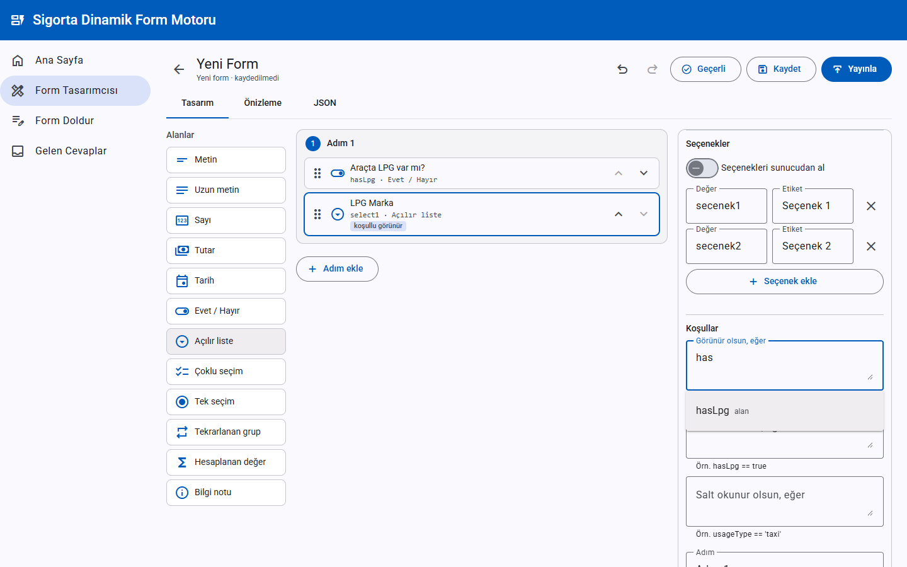
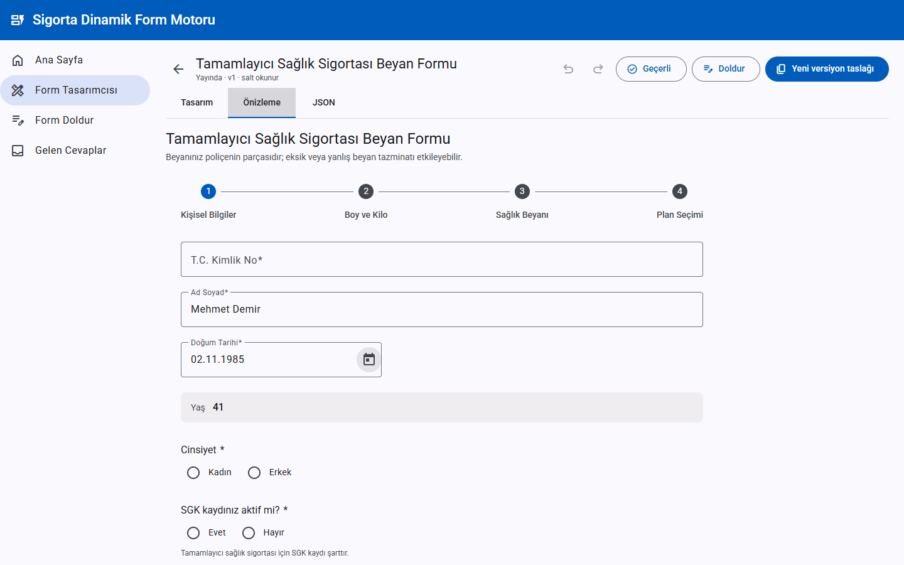
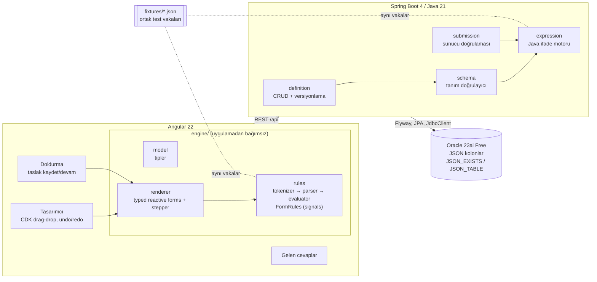

# Sigorta Dinamik Form Motoru

[](https://github.com/CeyDrew/insurance-dynamic-forms/actions/workflows/ci.yml)

Sigorta ürünlerinin (kasko, konut, sağlık, seyahat) risk soru setlerini **JSON tanımından** üreten form motoru:
sürükle-bırak tasarımcı, koşullu alanlar ve hesaplamalar için kendi ifade dili, versiyonlu tanımlar ve cevapları
sunucuda aynı kurallarla yeniden doğrulayıp Oracle'da JSON olarak saklayan bir backend. Ürün ekibi yeni soru ekler,
yayınlar; deploy gerekmez. Portföy projesidir, yalnızca lokal çalışır.

> **EN summary:** A dynamic form engine for insurance risk questionnaires. Forms are JSON definitions built in a
> drag-and-drop designer (Angular CDK), rendered as typed reactive forms driven by signals, and governed by a small,
> safe rule language with twin TypeScript and Java implementations held to one shared test fixture. Published
> versions are immutable; submissions are re-validated server-side and stored as JSON in Oracle, queried with
> `JSON_EXISTS` / `JSON_TABLE`. Runs locally with `docker compose up --build`.



## Hızlı başlangıç

Gereken: Docker Desktop (en az 4 GB bellek).

```bash
cp .env.example .env          # isterseniz şifreleri değiştirin
docker compose up --build     # ilk açılış: imaj build'leri ~4-6 dk, Oracle ~1-2 dk
```

| Adres | |
|---|---|
| http://localhost:4300 | Uygulama |
| http://localhost:8081/swagger-ui.html | API dokümantasyonu |
| http://localhost:8081/actuator/health | Backend sağlık kontrolü |

Şema Flyway ile kurulur; dört örnek form ilk açılışta v1 olarak yayınlanır. Kapatmak için `docker compose down`,
veriyi de silmek için `docker compose down -v`.

### Demo akışı (5 dakika)

1. **Form Doldur → Kasko Risk Formu.** Yakıt tipini *Benzin* seçin: "LPG var mı?" sorusu çıkar; *Evet* deyince LPG
   markası zorunlu olur. Model yılını girin: araç yaşı canlı hesaplanır. Sürücü ekleyin: 25 yaş altı sürücüde uyarı
   görünür. Sayfayı yenileyin: taslak kaldığınız adımdan devam eder. Gönderin.
2. **Gelen Cevaplar → "Örnek: LPG'li araçlar".** Filtre sunucuda `JSON_EXISTS` ile çalışır; satırı açınca saklanan
   kanonik JSON görünür (hesaplanan alanlar sunucuda yeniden hesaplanmış).
3. **Form Tasarımcısı → Yeni form.** Paletten *Evet / Hayır* ve *Metin* ekleyin, metne `Görünür olsun, eğer`
   kuralı yazın (alan adları otomatik tamamlanır, hata satır/sütunla gösterilir). *Önizleme* sekmesi gerçek
   renderer'dır. *Yayınla* → *Doldur*.
4. Yayınlanmış formu tasarımcıda açın: salt okunurdur; *Yeni versiyon taslağı* v2'yi açar.

## Ekranlar

| Doldurma (koşullu alanlar, hesaplama) | Gelen cevaplar (JSON filtresi) |
|---|---|
|  |  |

| Kural editörü (anlık kontrol + tamamlama) | Önizleme (gerçek renderer) |
|---|---|
|  |  |

## Mimari



- **Form tanımı:** tek bir JSON belgesi. Spesifikasyon: [`docs/form-definition-spec.md`](docs/form-definition-spec.md),
  örnekler: [`examples/`](examples).
- **Kural dili:** `hasLpg == true && modelYear >= 2015`, `currentYear() - modelYear`. Sözdizimi ve anlamı:
  [`docs/rule-language.md`](docs/rule-language.md). `eval` yok; iki dilde aynı parser ve yorumlayıcı.
- **Reaktivite:** her kural bir Angular `computed()` sinyali; bir alan değişince yalnızca onu okuyan kurallar yeniden
  hesaplanır. Gizli alan `null` okunur; bu yüzden görünürlük döngüleri de tanım doğrulamasında yakalanır.
- **Doğruluk:** cevaplar sunucuda aynı kurallarla yeniden doğrulanır; hesaplanan alanlar yeniden hesaplanır, gizli
  alanlar atılır. İki taraf `fixtures/` altındaki ortak vakalarla test edilir.

### Mimari kararlar (ADR)

- [0001 — Kurallar için kendi ifade dilimiz](docs/adr/0001-own-expression-language.md)
- [0002 — Tanımlar ve cevaplar Oracle'da JSON kolonlarda](docs/adr/0002-json-columns-in-oracle.md)
- [0003 — Yayınlanmış versiyon değiştirilemez](docs/adr/0003-immutable-published-versions.md)
- [0004 — Doğrulama iki tarafta, sunucu belirleyici](docs/adr/0004-validate-on-both-sides.md)

## Teknik öne çıkanlar

| Konu | Bu projede nerede |
|---|---|
| Angular (ileri seviye) | Standalone + **signals** + **typed reactive forms** + `OnPush`; tanımdan form üreten renderer ([`engine/renderer`](frontend/src/app/engine/renderer)), sinyal tabanlı bağımlılık grafiği ([`form-rules.ts`](frontend/src/app/engine/rules/form-rules.ts)), kendi `ControlValueAccessor`'ı (TL tutar girişi), CDK drag-drop tasarımcı, undo/redo |
| Java, Spring Boot | Spring Boot 4 / Java 21: REST, JPA, Flyway, RFC 9457 problem details, springdoc OpenAPI; recursive descent parser ve sealed interface + pattern matching ile AST ([`expression`](backend/src/main/java/com/portfolio/forms/expression)) |
| Oracle, SQL | `IS JSON` kolonlar, `JSON_EXISTS` ile cevap filtresi, `JSON_TABLE` ile repeater satırlarını SQL satırına açma ([`SubmissionQueries`](backend/src/main/java/com/portfolio/forms/submission/SubmissionQueries.java)), fonksiyon tabanlı unique index ile "tek taslak" kuralı, sequence'lar |
| Sigorta alan bilgisi | Kasko (LPG, sürücüler, hasar geçmişi), konut (DASK, yapı tarzı, UAVT), tamamlayıcı sağlık (VKİ, beyan), seyahat (Schengen, sigortalılar) soru setleri; yayınlanmış versiyonun değişmemesi |
| Test | ~240 backend (JUnit 5, **Testcontainers Oracle**), ~240 frontend (Vitest, Material harness), **Playwright** e2e; iki ifade motoru için ortak fixture |
| Takım pratikleri | Faz bazlı branch'ler, Conventional Commits, GitHub Actions CI, ADR'ler |

## Ana proje ile ilişkisi

Ana portföy projesi [**insurance-policy-management**](https://github.com/CeyDrew/insurance-policy-management)
poliçe yaşam döngüsünü ele alır: müşteri, teklif, poliçe, tahsilat, hasar, PL/SQL prim kuralları ve Spring Batch.
Bu proje onu **teklif öncesine** tamamlar: ürüne özel risk sorularını kodlamadan toplayan katman. İki proje bilerek
ayrı tutuldu (port çakışması da yok: bu proje 4300/8081/1522). Doğal entegrasyon noktası, bu motorun kanonik cevap
JSON'unun ana projede teklif oluşturma girdisi olmasıdır; örneğin kasko formundaki araç yaşı ve LPG bilgisi PL/SQL prim
hesabına parametre olarak gider.

## Geliştirme

Gerekenler: JDK 21+ (proje `release 21`), Node 24, Docker. Global Maven gerekmez.

```bash
docker compose up -d oracle                 # sadece veritabanı (host portu 1522)
cd backend && ./mvnw spring-boot:run        # http://localhost:8081
cd frontend && npm ci && npm start          # http://localhost:4300 (/api backend'e proxy'lenir)
```

| Komut | |
|---|---|
| `cd backend && ./mvnw verify` | Backend testleri (Oracle'ı Testcontainers açar) |
| `cd frontend && npm test` | Frontend unit testleri (Vitest) |
| `cd frontend && npx playwright test` | E2E; çalışan bir yığına karşı (`E2E_BASE_URL`, varsayılan :4300) |
| `cd frontend && SCREENSHOTS=1 npx playwright test screenshots` | README ekran görüntülerini yeniden üretir |

Repo düzeni:

```
backend/     Spring Boot: definition, submission, schema, expression, lookup
frontend/    Angular: engine/ (model, rules, renderer, fields), designer/, fill/, submissions/
docs/        spesifikasyon, kural dili, ADR'ler
examples/    4 ürün formu (backend ilk açılışta yayınlar)
fixtures/    iki ifade motorunun ve iki doğrulayıcının ortak test vakaları
```
